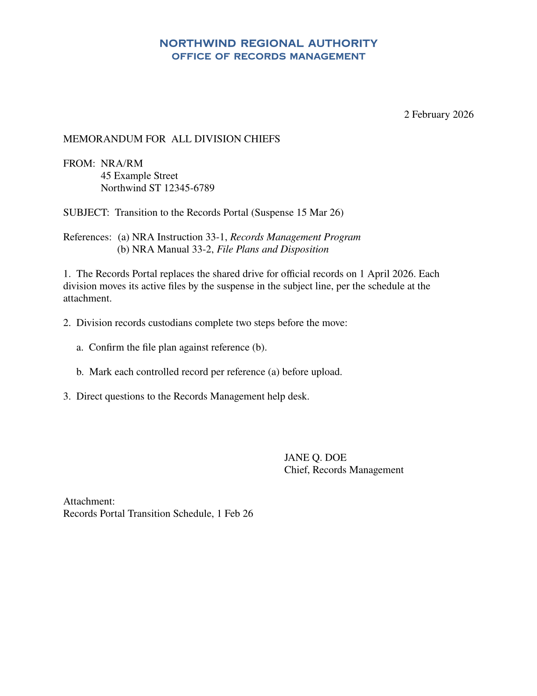
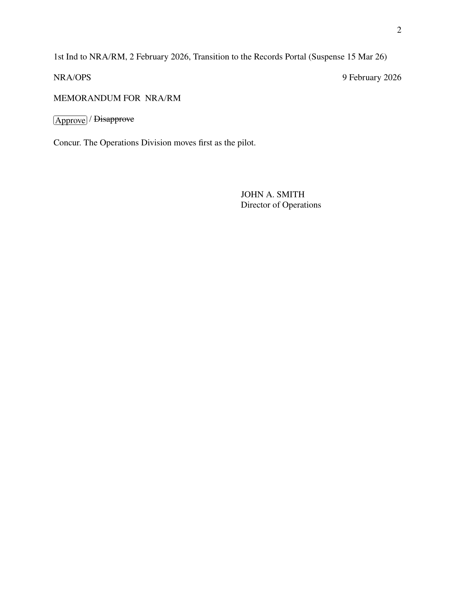

# Quillmark

[](https://crates.io/crates/quillmark)
[](https://pypi.org/project/quillmark/)
[](https://www.npmjs.com/package/@quillmark/wasm)
[](https://docs.rs/quillmark)

Quillmark renders Markdown into typeset PDF, SVG, and PNG documents. A **quill** defines the format: a schema that validates each document's fields and fills their defaults, and a plate that lays out the page (a Typst template, or a field map over an existing PDF form). Authors write only the content.

<div class="grid" markdown>

{ style="border: 1px solid var(--md-default-fg-color--lightest)" }

{ style="border: 1px solid var(--md-default-fg-color--lightest)" }

</div>

??? example "The Markdown behind these pages, rendered through the `usaf_memo` quill"

    ```markdown
    --8<-- "docs/assets/gallery/memo.md"
    ```

<small>Quillmark is not affiliated with or endorsed by the Department of Defense, the Department of the Air Force, or any Military Service.</small>

[Why Quillmark, and when not to use it](getting-started/why.md)

!!! warning "Pre-1.0"
    The API changes between minor releases, and each breaking release ships a guide under [Migration](migrations/index.md). A document saved as [versioned JSON](integration/persistence.md) carries a version tag, and later releases migrate supported past versions forward on read.

## Choose your path

- **Writing documents?** You write Markdown documents that target a Quill format.  
  → [Markdown Syntax](authoring/markdown-syntax.md)

- **Building quills?** You create Quill formats that control rendering.  
  → [Creating Quills](quills/creating-quills.md)

- **Integrating into an app?** You use Quillmark via Python or JavaScript.  
  → [Quickstart](getting-started/quickstart.md) · [Integrating Quillmark](integration/index.md)

- **Using the CLI?** You render and validate from the command line.  
  → [CLI Reference](cli/reference.md)

- **Using Rust?** API documentation is on [docs.rs](https://docs.rs/quillmark).
